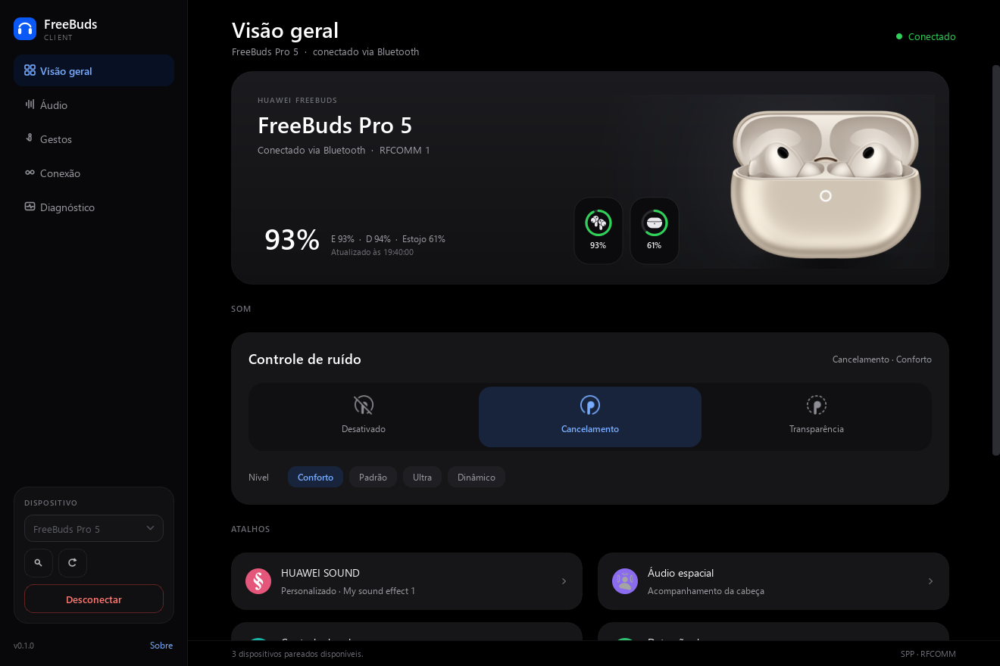

# FreeBuds Client

[](https://github.com/hrbtnog/freebuds-client/actions/workflows/ci.yml)
[](LICENSE)

Cliente desktop **não oficial** para gerenciar fones HUAWEI FreeBuds no Windows,
inspirado na ergonomia do Galaxy Buds Client. O objetivo é oferecer bateria,
controle de ruído, equalizador, gestos, multiponto e testes de hardware sem a
conta Huawei e sem o HUAWEI AI Life.

> **English:** An unofficial Windows desktop client for HUAWEI FreeBuds. This is
> a personal project by someone who is not a developer; it is experimental, not
> affiliated with Huawei, and suggestions/corrections are very welcome.

## Sobre mim e por que este projeto existe

Eu **não sou programador** e nunca trabalhei com desenvolvimento de software.
Este é um projeto pessoal de aprendizado: eu queria uma forma de ver a bateria e
controlar o cancelamento de ruído do meu FreeBuds Pro 5 pelo PC, sem depender do
celular e sem usar o HUAWEI AI Life.

Vale destacar que a proposta do aplicativo não é substituir a necessidade de um smartphone com o Huawei AI Life ou Huawei Audio Connect para o gerenciamento completo do fone. Recursos como equalização personalizada, configurações da case, função buscar, teste de ajuste das ponteiras e outros ajustes avançados não existem neste projeto por enquanto (e alguns podem nem ser implementados por conta de limitações técnicas).

A ideia inicial é apenas complementar a experiência de uso, oferecendo um acesso rápido e prático às principais funções diretamente pelo Windows, preenchendo uma lacuna que a própria Huawei não disponibiliza nativamente.

Não é um produto comercial. Não tem suporte oficial, prazo ou garantia. O código
foi escrito com assistência de IA e testado por mim no hardware que eu tenho.
Se você encontrar algo estranho, me avise que eu tento corrigir. Estou aberto a
sugestões, críticas, issues e pull requests. Se você é programador e quiser
revisar ou apontar erros, será muito bem-vindo. Se você só tem o fone e quer
testar, também ajuda muito.

## Aviso importante

- **Use por sua conta e risco.** Este software conversa com o fone por Bluetooth
  e pode alterar configurações. Não há garantia de que funcione em outro modelo,
  firmware ou revisão de hardware.
- **Projeto não oficial.** Não é afiliado, patrocinado ou endossado pela Huawei,
  HONOR ou qualquer fabricante. Marcas e imagens pertencem aos seus donos; veja
  [`NOTICE.md`](NOTICE.md).
- **Não faz atualização de firmware** e não tenta contornar pareamento, PIN,
  passkey ou confirmações de segurança do Windows.
- **Não publique dados pessoais.** Evite colar endereço Bluetooth completo,
  serial, capturas HCI ou nomes de dispositivos em issues, prints e PRs.
- **Ainda é experimental.** A versão visual atual foi exercitada no Windows e
  por renderização offscreen; a validação completa da nova interface em hardware
  ainda está pendente.

## Status do projeto

> **Status:** Fases 1 e 2 implementadas. O núcleo, a CLI de diagnóstico e a
> documentação de engenharia reversa foram validados em hardware em
> **2026-10-21** com um FreeBuds Pro 5 no canal `1`: listagem, handshake, bateria
> e os três modos de ANC responderam. O nível de transparência `4` foi
> identificado como **Reconhecimento adaptável**, com 11 níveis; mudanças de ANC
> chegam como notificações `0x2B2A`. Em **2026-10-23** a UI PySide6 com bandeja
> foi validada com o fone conectado ao PC e ao celular ao mesmo tempo. A escrita
> de ANC (`0x2B04`) e as preferências avançadas (HUAWEI SOUND, áudio espacial,
> volume adaptável, reconhecimento de conversa, controle de cabeça, detecção de uso,
> qualidade de som, baixa latência, ANC com um fone e gestos configuráveis) foram
> integradas à interface e validadas no fone com reversão e confirmação por leitura.
> Em **2026-10-28** a interface foi redesenhada a partir das capturas do HUAWEI
> Audio Connect, com rail lateral HarmonyOS, páginas, cartões amplos, segment
> controls e bateria em pastilhas. A UI acorda imediatamente com notificações
> espontâneas e a suíte conta com **89 testes automatizados passando**.
> Multiponto e gesto de deslizar permanecem somente leitura por segurança.
> Este projeto não é afiliado à Huawei e não faz atualização de firmware.

## Documentação

- [`docs/PROTOCOL.md`](docs/PROTOCOL.md) — formato do quadro, CRC, TLVs e
  comandos conhecidos.
- [`docs/ARCHITECTURE.md`](docs/ARCHITECTURE.md) — camadas, threading e fluxos do
  `probe` e da UI.
- [`docs/CAPTURE_GUIDE.md`](docs/CAPTURE_GUIDE.md) — como capturar o tráfego do
  Android e correlacionar comandos.
- [`CHECKPOINT.md`](CHECKPOINT.md) — ponto de restauração com o estado atual, a
  validação em hardware e os próximos passos.
- [`CONTRIBUTING.md`](CONTRIBUTING.md) — como testar, sugerir e enviar mudanças.
- [`CODE_OF_CONDUCT.md`](CODE_OF_CONDUCT.md) — convivência no projeto.
- [`SECURITY.md`](SECURITY.md) — privacidade e como relatar problemas sensíveis.
- [`NOTICE.md`](NOTICE.md) — marcas e materiais de terceiros.
- [`LICENSE`](LICENSE) — licença MIT do código original.
- [`docs/PUBLISHING.md`](docs/PUBLISHING.md) — passo a passo para publicar no
  GitHub (útil para o autor e para forks).

## Design da interface

As capturas do HUAWEI Audio Connect usadas como referência durante o
desenvolvimento não fazem parte do repositório (são materiais locais e podem
conter nomes de dispositivos). O redesenho de 2026-10-28 adapta essa linguagem
para uma janela desktop:

- rail lateral fixo com navegação, marca e seleção de dispositivo;
- conteúdo em coluna central com largura máxima, para não esticar cartões em
  monitores grandes;
- cartões de raio 24 px, hero de 28 px e separadores de 1 px;
- três níveis tipográficos (título de página, título de cartão e texto de apoio),
  com rótulos de seção em caixa alta e pouco contraste;
- segment controls com ícone e rótulo para o controle de ruído, chips de nível e
  switches azuis;
- azul HUAWEI `#0A59F7` reservado a estado ativo, links e ação primária;
- ícones de ruído, áudio espacial, equalização e recursos em SVG, dentro das
  molduras circulares coloridas dos cartões e atalhos; os arquivos finais ficam
  em `src/freebuds/ui/assets/icons`;
- popups de seleção com cantos arredondados e largura calculada pelo maior item;
- pastilhas verticais de bateria com anel, ícone de fone/estojo e porcentagem
  centralizados, como na tela inicial do app oficial;
- páginas separadas para Áudio, Gestos, Conexão e Diagnóstico, com o log e as
  preferências fora do caminho da operação diária.



Outras telas: [Áudio](docs/ui/audio.png), [Gestos](docs/ui/gestos.png),
[Conexão](docs/ui/conexao.png), [Diagnóstico](docs/ui/diagnostico.png),
[Reconhecimento adaptável](docs/ui/adaptavel.png) e
[estado desconectado](docs/ui/desconectado.png). As capturas usam dados
sintéticos e a foto ilustrativa do produto. A foto e os ícones de interface são
materiais de terceiros; veja [`NOTICE.md`](NOTICE.md).

## O que já existe

- Descoberta e listagem de dispositivos Bluetooth Classic via API nativa do
  Windows.
- Pareamento assistido pelo Windows (`BluetoothAuthenticateDeviceEx`), sem
  contornar PIN, passkey ou confirmação do usuário.
- Transporte RFCOMM/SPP com tentativa de canais conhecidos (`1` e `16`) e
  persistência do canal que funcionou.
- Codec completo do protocolo Huawei: quadro `0x5A`, TLV, CRC16/XMODEM e parser
  incremental que tolera fragmentação, frames concatenados e lixo.
- Handshake de identificação (`0x0107`), leitura de bateria (`0x0108`) e leitura
  de ANC (`0x2B2A`).
- Controle de ANC por `0x2B04`: modos normal, cancelamento e transparência,
  níveis de cancelamento/transparência conhecidos e Reconhecimento adaptável com
  11 níveis, com confirmação e releitura pelo fone.
- Cliente de alto nível em `core/client.py`, reutilizado pela UI, com conexão por
  canais, handshake, snapshot, espera por notificações e reconexão.
- CLI com saída humana ou JSON, `--raw`, `--listen` e decodificação de capturas.
- UI desktop em PySide6 com rail de navegação no estilo HarmonyOS:
  **Visão geral**, **Áudio**, **Gestos**, **Conexão** e **Diagnóstico**.
  A visão geral tem hero com foto transparente e pastilhas de bateria, cartão de
  controle de ruído com segment control, atalhos e bateria detalhada; as demais
  páginas usam cartões de ajuste e linhas agrupadas. Inclui log de atividade,
  polling de segurança e bandeja do sistema.
- Controle avançado de Áudio: perfis HUAWEI SOUND em grade, áudio espacial
  (modo e efeito), volume adaptável e reconhecimento de conversa.
- Controle de Gestos: pressionar e segurar, pinçar e segurar, toque duplo,
  toque triplo, controle por movimentos de cabeça (aceno e balanço) e visualização
  de deslizar.
- Controle de Conexão: prioridade de codec (conexão vs áudio), modo de baixa
  latência, detecção de uso inteligente, cancelamento com um fone e status de
  multi-conexão.
- Atualização em tempo real: o worker acorda quando o fone envia notificações
  espontâneas (ex.: `0x2B2A` ou mudanças de perfil) e lê um novo snapshot sem
  esperar o intervalo de polling.
- Configurações persistentes em `%APPDATA%\FreeBudsClient\settings.json`.
- Núcleo independente de Qt: a UI consome snapshots sem reimplementar a
  comunicação.

### Validação em hardware

Execuções reais no canal `1` com o FreeBuds Pro 5 reportando modelo interno
`BTFT0023` e firmware HarmonyOS 7.0.0.350 (F003H003C91):

| Item | Resultado |
|---|---|
| Listagem e conexão SPP | OK — dispositivo já pareado, conectado no canal `1` |
| Handshake `0x0107` | OK — 14 campos retornados |
| Bateria `0x0108` | OK — global, L/R, estojo e flags |
| ANC `0x2B2A` | OK no modo normal (`00 00`) |
| ANC cancelamento | OK — `03 01` = dynamic/cancellation |
| ANC transparência | OK — `04 02` = Reconhecimento adaptável; posição no parâmetro `2` |
| Reconhecimento adaptável | OK em 2026-10-23 — 11 níveis (`0x00..0x0A`), seleção, escrita e restauração confirmadas |
| Escrita de ANC `0x2B04` | OK em 2026-10-23 — modos `00 00`, `01 FF`, `02 02`, `02 04` e níveis de cancelamento/adaptativo; estado restaurado |
| Recursos avançados (Áudio/Gestos/Conexão) | OK em 2026-10-23 — HUAWEI SOUND, áudio espacial, adaptativo, cabeça, detecção de uso, qualidade, latência e gestos confirmados e restaurados |
| Notificações espontâneas | OK — pushes de ANC `0x2B2A` acordam o worker imediatamente; `0x2BAC` preservado |
| UI PySide6 com abas + bandeja | OK em 2026-10-23 com o fone conectado ao PC e celular: hero, abas, switches, chips, combos, reconexão e bandeja |
| Redesign HarmonyOS (rail, páginas) | OK em 2026-10-28 na renderização offscreen em 1320×880 e 1100×760, nos estados conectado, desconectado e adaptável; falta repetir com o fone |
| Pareamento assistido do zero | ainda não reexecutado (o fone já estava pareado) |
| Bateria `0x0127` e `0x2BAC` | `0x0127` pendente; `0x2BAC` observado, mas sem semântica |

> A UI também foi exercitada com dados sintéticos e sem rádio Bluetooth: mostra a
> mensagem de rádio indisponível e continua aberta. A validação de 2026-10-23
> cobriu o fluxo básico, o adaptável e as novas páginas de recursos; ainda faltam DPI alto,
> suspensão/retomada do Windows e uma perda de enlace real (o teste de reconexão parou
> e reiniciou o worker).

### O que falta validar em hardware

- DPI alto e ciclos de suspensão/retomada do Windows com a UI conectada.
- Reconexão após o fone ser desligado/religado ou sair e voltar ao alcance.
- Pareamento do zero em um dispositivo ainda não lembrado pelo Windows.
- Notificação espontânea do nível adaptativo quando o celular muda o slider.
- Layouts de bateria, flags de carga e notificações em outros modelos.

## Por que Bluetooth Classic e não BLE?

Os FreeBuds expõem o canal de controle proprietário sobre **SPP/RFCOMM**
(UUID de serviço `00001101-0000-1000-8000-00805F9B34FB`), com quadros `0x5A`.
BLE é usado por outros acessórios, mas não é o caminho principal desses fones.
O canal RFCOMM varia por firmware/modelo (por exemplo, Pro/Pro 2/Pro 3/Pro 5 e
6i usam `1`; 4i e 5i usam `16`). Por isso a CLI tenta canais conhecidos e aceita
`--channel`.

## Requisitos

- Windows 10/11 com Bluetooth Classic habilitado.
- Python 3.11+ (o desenvolvimento atual usa 3.14).
- Fones pareados no Windows, ligados e fora do estojo.
- O app oficial no celular não deve estar mantendo uma sessão SPP ativa ao mesmo
  tempo. Áudio A2DP pode continuar conectado.

## Para quem não é programador

Ainda não existe instalador `.exe`. Para usar hoje é necessário instalar Python
e rodar alguns comandos; se você não tem familiaridade com terminal, siga o passo
a passo e, se algo falhar, abra uma issue com a mensagem de erro. Empacotar um
executável está nos próximos passos. Se você só quer testar e contar o resultado,
isso também ajuda muito.

## Instalação local

```powershell
py -m venv .venv
.\.venv\Scripts\Activate.ps1
python -m pip install -e ".[dev,ui]"
```

Para usar apenas a CLI, sem instalar Qt, troque por `".[dev]"`.

Sem ativar a venv:

```powershell
.\.venv\Scripts\python.exe -m pip install -e ".[dev,ui]"
.\.venv\Scripts\freebuds.exe list
```

## Uso da CLI

Os exemplos usam o endereço fictício `AA:BB:CC:DD:EE:FF`. Substitua pelo
endereço real retornado por `freebuds scan` ou `freebuds list`.

```powershell
# Versão instalada
freebuds --version

# Dispositivos já conhecidos/pareados pelo Windows
freebuds list
freebuds list --json

# Inclui dispositivos não pareados, fazendo inquiry Bluetooth Classic
freebuds scan --seconds 8

# Mostra todos os dispositivos, não só nomes Huawei/HONOR/FreeBuds
freebuds scan --seconds 8 --all

# Pareamento assistido (o Windows pode exibir um assistente/SSP)
freebuds pair AA:BB:CC:DD:EE:FF

# Handshake + bateria + ANC; tenta canais 1 e 16 automaticamente
freebuds probe --name "FreeBuds"

# Força um canal, mostra bytes TX/RX e gera JSON
freebuds probe --address AA:BB:CC:DD:EE:FF --channel 1 --json --raw

# Escuta notificações por 15 s depois do snapshot inicial
freebuds probe --name FreeBuds --listen 15

# Decodifica uma sequência de bytes ou um arquivo de texto hexadecimal
freebuds decode "5A0006002B03080100A79D"
freebuds decode --file capturas/spp.txt
```

Observações:

- `probe --name` procura apenas dispositivos **já lembrados** pelo Windows. Se o
  fone ainda não apareceu, rode `scan` primeiro ou use `--address`.
- `freebuds list` retorna código de saída `2` quando o Windows não expõe um rádio
  Bluetooth Classic (rádio desligado, ausente ou driver sem suporte).
- O `probe` é **somente leitura**: não altera ANC, EQ, gestos, multiponto nem
  configurações. A escrita de ANC está disponível apenas na UI e usa confirmação
  do fone. Outras escritas só serão habilitadas após validação em cada
  modelo/firmware.
- O canal que funcionar é salvo nas preferências, a menos que `--no-save` seja
  usado.

## Uso da UI

A interface usa PySide6 (extra `ui`) e pode ser aberta de três formas:

```powershell
# Pela CLI
freebuds ui

# Script dedicado
freebuds-ui

# Também funciona como módulo
python -m freebuds ui
```

Para já tentar conectar a um endereço específico:

```powershell
freebuds ui --address AA:BB:CC:DD:EE:FF
```

O que a UI oferece nesta versão:

- rail lateral com marca, navegação e seleção de dispositivo; a janela abre em
  **Visão geral** e o tamanho inicial se adapta à área útil do monitor;
- lista de dispositivos Bluetooth clássicos já conhecidos pelo Windows;
- botão **Procurar** com inquiry de 8 segundos, sem bloquear a janela;
- conexão/desconexão pelo cliente de alto nível, com tentativa automática dos
  canais salvos e conhecidos;
- **Visão geral**: hero com foto transparente dos fones e pastilhas de bateria,
  cartão de **controle de ruído** com segment control, atalhos para HUAWEI SOUND,
  áudio espacial, controle de cabeça e detecção de uso, e bateria detalhada;
- **Áudio**: perfis HUAWEI SOUND em grade, áudio espacial (modo e efeito), volume
  adaptável e reconhecimento de conversa;
- **Gestos**: pressionar e segurar, pinçar e segurar, toques duplos/triplos,
  controle por movimentos de cabeça e visualização de deslizar;
- **Conexão**: prioridade de codec, latência baixa, detecção de uso, ANC com um
  fone e status de multi-conexão;
- **Diagnóstico**: log de atividade, informações técnicas (modelo, submodelo,
  firmware, hardware, canal e última leitura) e preferências de polling e bandeja;
- **controle de ANC**: normal, cancelamento e transparência, com níveis de
  cancelamento (Padrão, Conforto, Ultra, Dinâmico), de transparência (Realce de
  voz, Normal) e o **Reconhecimento adaptável** com um slider de 11 níveis
  (1 = mais ruído, 6 = padrão, 11 = menos ruído);
- confirmação e restauração do estado após cada escrita; se o fone não responder
  ou não confirmar o novo estado, a UI mantém o estado anterior e registra o erro;
- atualização em tempo real por notificações espontâneas; o polling de
  15/30/60/120 s fica como verificação de segurança em **Diagnóstico**;
- ícone de bandeja com bateria/ANC, menu para abrir, atualizar ou sair, e opção
  de fechar a janela mantendo o app em background.

A UI envia ANC (`0x2B04`) e os ajustes de áudio, gestos e conexão confirmados no
hardware, sempre com restauração em caso de falha. Multiponto, efeitos espaciais,
tons do estojo e o gesto de deslizar permanecem somente leitura. Os controles
ficam desabilitados enquanto não há sessão ou enquanto uma ação está em andamento.

A foto do produto em `src/freebuds/ui/assets/freebuds_pro_5.png` foi preparada
com fundo transparente para esta interface. É uma imagem ilustrativa do produto,
de propriedade da HUAWEI; substitua por uma foto própria antes de distribuir o
aplicativo.

Se o Bluetooth estiver desligado, a janela continua funcional e exibe a mensagem
de rádio indisponível.

Preferências adicionais da UI (`poll_interval` e `close_to_tray`) são salvas no
mesmo `settings.json` da CLI.

## Testes e verificação

```powershell
.\.venv\Scripts\python.exe -m pytest
.\.venv\Scripts\python.exe -m ruff check src tests
.\.venv\Scripts\python.exe -m compileall -q src tests
```

A suíte cobre codec/CRC, parser incremental, builders e decodificação, sessão
RFCOMM simulada, cliente de alto nível, espera por notificações, escrita de ANC,
configurações, orquestração da CLI e testes offscreen da UI (quando PySide6 está
instalado), incluindo navegação entre páginas, atalhos da visão geral, o modo
adaptável e seus 11 níveis. Estado atual: **89 testes**. Nenhum teste automatizado
substitui a validação com os fones reais.

O GitHub Actions roda Ruff, compileall e pytest em Windows com Python 3.11 e 3.12
a cada push e pull request. O workflow está em
[`.github/workflows/ci.yml`](.github/workflows/ci.yml).

## Estrutura

```text
src/freebuds/
  core/
    protocol.py      # quadro, TLV, CRC, parser incremental (sem Windows)
    commands.py      # IDs, requests e decodificação semântica
    client.py        # conexão de alto nível e snapshots para CLI/UI
    transport.py     # socket RFCOMM/SPP
    session.py       # correlação request/response e thread de leitura
    windows_bt.py    # enumeração, inquiry e pareamento no Windows
    models.py        # dataclasses de estado
  config/
    settings.py      # preferências persistentes
  cli/
    app.py           # CLI
  ui/
    app.py           # QApplication e entrada
    main_window.py   # janela principal, rail e páginas
    worker.py        # threads de conexão/polling, notificações e varredura
    widgets.py       # hero, bateria, ANC, cartões, linhas e log
    tray.py          # ícone e menu da bandeja
    theme.py         # stylesheet HarmonyOS
    icons.py         # marca, bandeja, navegação e fallback
    svg_icons.py     # renderização e tintura dos SVGs de recursos
    assets/          # foto transparente do produto e icons/*.svg
docs/
  ARCHITECTURE.md
  PROTOCOL.md
  CAPTURE_GUIDE.md
  PUBLISHING.md
  ui/                # capturas sintéticas usadas no README
tests/
```

## Limitações conhecidas

- O protocolo e os IDs foram mapeados por pesquisa pública (OpenFreebuds,
  LibreBuds, mmk.pw, Gadgetbridge) e confirmados parcialmente no FreeBuds Pro 5.
  A disponibilidade de cada campo ainda varia por modelo e firmware.
- A leitura de bateria via `0x0108` é a principal; alguns firmwares podem enviar
  notificações `0x0127` em vez de responder de forma síncrona.
- A carga por componente (`param 3` do `0x0108`) é apresentada apenas quando o
  payload tem o formato esperado. Caso contrário, o valor bruto é preservado e a
  UI não deve inventar estados. No FreeBuds Pro 5 os três bytes vieram `01`, mas
  o mapeamento por componente não foi confirmado.
- Os campos `0x02`, `0x19`, `0x1B`, `0x1D`, `0x1E`, `0x21` e `0x22` do
  `0x0107`, os parâmetros `4`–`6` da bateria e a notificação `0x2BAC` ainda não
  têm significado confirmado; são preservados como brutos.
- Os três modos de ANC, os níveis de cancelamento e os 11 níveis do
  Reconhecimento adaptável foram testados em hardware. A posição adaptativa usa
  o TLV `4` (`0x00..0x0A`) e a interface a apresenta como `1..11`; o valor bruto
  `0x05` corresponde ao padrão `6`. A escrita só é aceita com confirmação e
  releitura do fone.
- O pareamento usa a UI/SSP do Windows. Não há tentativa de contornar prompts de
  segurança.
- O canal RFCOMM é fixo por modelo na implementação atual; uma consulta SDP
  dinâmica seria mais robusta.
- A UI escreve ANC e os ajustes de áudio/gestos/conexão confirmados no Pro 5.
  O fluxo de conexão e leitura foi validado com o fone conectado em 2026-10-23;
  ainda faltam DPI alto, suspensão/retomada e perda real de enlace.
- O polling de segurança padrão é de 30 segundos, mas mudanças de ANC/bateria
  chegam por notificação e são aplicadas imediatamente. A reconexão tenta
  novamente a cada 12 segundos; a bandeja pode não estar disponível em sessões
  remotas, e nesse caso a janela fecha normalmente.
- Áudio espacial, HUAWEI SOUND, áudio adaptável, gestos e conexão foram
  implementados e validados no Pro 5; multiponto e o gesto de deslizar continuam
  somente leitura. Outros modelos/firmwares podem não aceitar os mesmos comandos.
- Não há suporte a atualização de firmware, e ele não será implementado por
  engenharia reversa.

## Como contribuir e enviar sugestões

Este projeto é aberto a sugestões, correções e pull requests. Eu não tenho
compromisso de prazo e respondo quando consigo, mas toda ajuda é bem-vinda.

- **Encontrou um problema?** Abra uma issue usando o template de bug. Inclua
  modelo do fone, firmware, versão do Windows, o que você fez e o que aconteceu.
- **Tem uma ideia?** Use o template de sugestão. Não precisa saber programar para
  sugerir uma melhoria de uso, texto ou comportamento.
- **Quer enviar código?** Leia [`CONTRIBUTING.md`](CONTRIBUTING.md), rode os
  testes e descreva o hardware em que você testou.
- **Não publique dados pessoais** em issues, prints ou PRs: endereço Bluetooth
  completo, serial, capturas HCI, nomes de dispositivos ou dados da sua rotina.
- **Se você é desenvolvedor**, uma revisão de código, de threading/Qt ou do
  protocolo vale muito. Se você não é, sua experiência como usuário também conta.

Ajudas especialmente úteis: testar em outros modelos/firmwares, DPI alto,
suspensão/retomada, perda real de enlace, instalador `.exe`, acessibilidade e
traduções.

## Segurança e escopo

- Use o projeto apenas com dispositivos seus.
- Não publique endereços Bluetooth completos, seriais ou capturas com dados
  pessoais sem redigir.
- Comece sempre por leituras. Qualquer comando de escrita deve ser confirmado
  por captura e testado com uma forma de reverter.
- Não replique comandos de firmware.
- Leia também [`SECURITY.md`](SECURITY.md) antes de abrir uma issue com logs.

## Próximos passos

1. Validar DPI alto, suspensão/retomada e reconexão após perda real de enlace
   com a UI conectada.
2. Observar a notificação espontânea do nível adaptativo quando o slider é
   movido pelo celular e confirmar a atualização imediata da UI.
3. Mapear as opções de áudio espacial, HUAWEI SOUND/equalizador, áudio adaptável
   de volume, gestos e multiponto por captura do app oficial; só então habilitar
   escritas com confirmação e reversão.
4. Observar notificações de bateria e testar `--listen` em outros firmwares para
   confirmar se eles usam `0x2B03` em vez do `0x2B2A` espontâneo.
5. Validar o pareamento do zero em outro PC ou após remover o dispositivo.
6. Repetir a validação em outros modelos/firmwares e preencher a tabela de
   `docs/PROTOCOL.md`.

## Licença

O código original deste repositório está sob a licença **MIT** — veja
[`LICENSE`](LICENSE). A licença não cobre a foto do produto, os ícones de
interface, marcas ou outros materiais de terceiros; veja [`NOTICE.md`](NOTICE.md).
Se você é titular de algum material usado aqui e quer que ele seja removido,
abra uma issue.

## Referências e agradecimentos

- OpenFreebuds — https://github.com/melianmiko/OpenFreebuds
- LibreBuds — https://github.com/librebuds/librebuds
- Protocolo FreeBuds 4i — https://mmk.pw/en/posts/freebuds-4i-proto/
- Freebuds playground — https://gist.github.com/melianmiko/02f7c6a550808e38d9b6760fb688e125
- Gadgetbridge (FreeBuds) — https://codeberg.org/Freeyourgadget/Gadgetbridge

Obrigado a quem testou, abriu issues e apontou erros. Este projeto não existiria
sem a documentação pública desses projetos e sem as pessoas que responderam
perguntas em fóruns. Se você encontrar este repositório e quiser melhorar algo,
sinta-se em casa para abrir uma issue — mesmo que seja só uma sugestão de texto.
